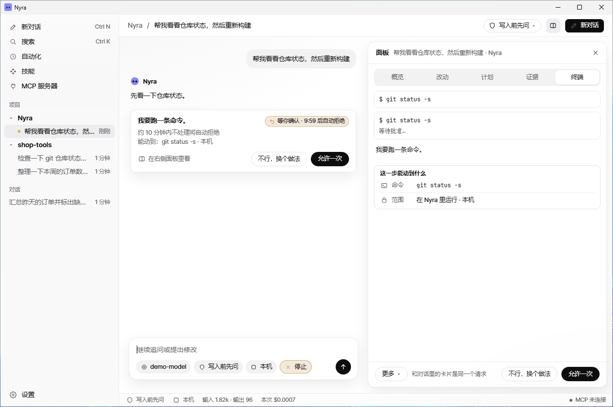

<div align="center">


# Nyra

**An open-source AI agent that runs on your own computer: it reads your project, edits code, runs commands and checks the web, and asks before it acts.**

[Website](https://js2005happy.github.io/nyra/) &nbsp;·&nbsp; [Download](https://github.com/js2005happy/nyra/releases/latest) &nbsp;·&nbsp; [Getting started](docs/beta.en.md)

Nyra is an **open-source** AI agent that **runs on your own computer**. Use it from a **desktop window**, the **terminal** or a **browser**, and pair your **phone** to follow along and approve steps. Bring **your own model key** (or a local model); conversations, memory and keys **stay on your machine**.

Hand it a task and it reads the project, edits code, runs commands and checks the web on its own. Before it writes a file or runs a command, an approval card says exactly what it is about to do. Say what you need. Watch it work. Nothing important happens until you say yes.

[](https://github.com/js2005happy/nyra)
[](https://github.com/js2005happy/nyra/releases/latest)
[](docs/mobile-pwa.md)
[](https://github.com/js2005happy/nyra/releases/latest)
[](https://github.com/js2005happy/nyra/actions/workflows/node-ci.yml)
[](CONTRIBUTING.md)

<br>

<a href="https://github.com/js2005happy/nyra/releases/latest/download/Nyra-windows-x64-setup.exe"></a>

<a href="https://github.com/js2005happy/nyra/releases/latest/download/Nyra-macos-universal.dmg"></a>

<a href="https://github.com/js2005happy/nyra/releases/latest/download/Nyra-linux-x86_64.AppImage"></a>

<a href="https://github.com/js2005happy/nyra/releases/latest/download/Nyra-linux-amd64.deb"></a>

<a href="https://github.com/js2005happy/nyra/releases/latest/download/nyra-android.apk"></a>

<sub>[latest release](https://github.com/js2005happy/nyra/releases/latest) &nbsp;·&nbsp; Windows x64 installer: **not code-signed** yet (SmartScreen: More info → Run anyway) &nbsp;·&nbsp; macOS universal `.dmg` (Apple silicon & Intel): ad-hoc signed, **not notarized** (right-click → Open the first time) &nbsp;·&nbsp; Linux x64: AppImage or `.deb` &nbsp;·&nbsp; Android APK: **release-signed** (signer CN=Nyra); upgrading from an older debug-signed build needs one uninstall, later updates install over it &nbsp;·&nbsp; [all releases](https://github.com/js2005happy/nyra/releases) &nbsp;·&nbsp; [中文](README.md)</sub>

<br>



<sub>Real screenshots of the running app (set to Chinese); the demo conversation is scripted.</sub>

</div>

## Quick start

| Platform | Download |
|---|---|
| Windows x64 | [Nyra-windows-x64-setup.exe](https://github.com/js2005happy/nyra/releases/latest/download/Nyra-windows-x64-setup.exe) · [.msi](https://github.com/js2005happy/nyra/releases/latest/download/Nyra-windows-x64.msi) |
| macOS (Apple silicon & Intel) | [Nyra-macos-universal.dmg](https://github.com/js2005happy/nyra/releases/latest/download/Nyra-macos-universal.dmg) |
| Linux x64 | [AppImage](https://github.com/js2005happy/nyra/releases/latest/download/Nyra-linux-x86_64.AppImage) · [.deb](https://github.com/js2005happy/nyra/releases/latest/download/Nyra-linux-amd64.deb) |
| Android | [nyra-android.apk](https://github.com/js2005happy/nyra/releases/latest/download/nyra-android.apk) |

Command line only:

```bash
curl -fsSL https://raw.githubusercontent.com/js2005happy/nyra/main/scripts/install-node.sh | bash        # Linux
curl -fsSL https://raw.githubusercontent.com/js2005happy/nyra/main/scripts/install-node-macos.sh | bash  # macOS
```

```powershell
irm https://raw.githubusercontent.com/js2005happy/nyra/main/scripts/install-node.ps1 | iex   # Windows
```

Then run `nyra setup`. The scripts verify each download against the release `SHA256SUMS` and refuse to install on a mismatch.

Full guide: [GUIDE.en.md](GUIDE.en.md) (Chinese: [README.md](README.md), [GUIDE.md](GUIDE.md)). Install details: [installers](docs/installers.en.md) · [macOS](docs/macos-install.en.md) · [Windows](docs/windows-install.en.md). Contributions: [CONTRIBUTING.md](CONTRIBUTING.md) · Security: [SECURITY.md](SECURITY.md).

## Contributing

Nyra is in beta. Try it, tell us what works and what doesn't, and help improve it:

- **Feedback**: [beta sign-up & feedback hub](https://github.com/js2005happy/nyra/issues/131) (pinned) · [report a bug / share feedback](https://github.com/js2005happy/nyra/issues/new/choose) (never paste API keys)
- **Discussions**: [Discussions](https://github.com/js2005happy/nyra/discussions) for beta feedback, ideas and show-and-tell
- **Start small**: [good first issues](https://github.com/js2005happy/nyra/issues?q=is%3Aissue+is%3Aopen+label%3A%22good+first+issue%22) are self-contained tasks; comment to claim one
- **How to submit**: development setup, test commands and commit conventions are in [CONTRIBUTING.md](CONTRIBUTING.md)

## License

[MIT](LICENSE)
