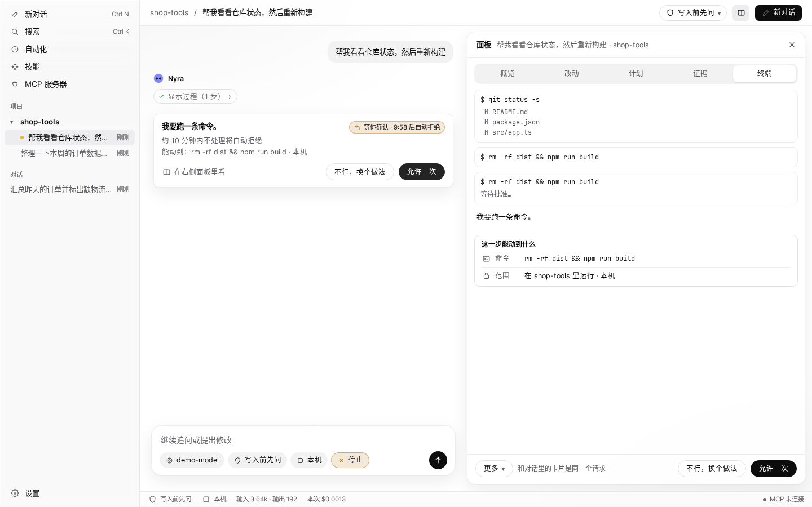
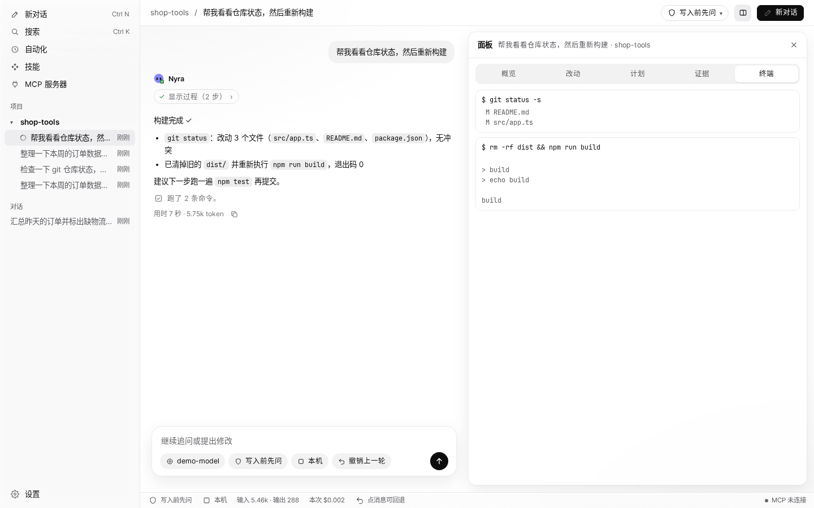
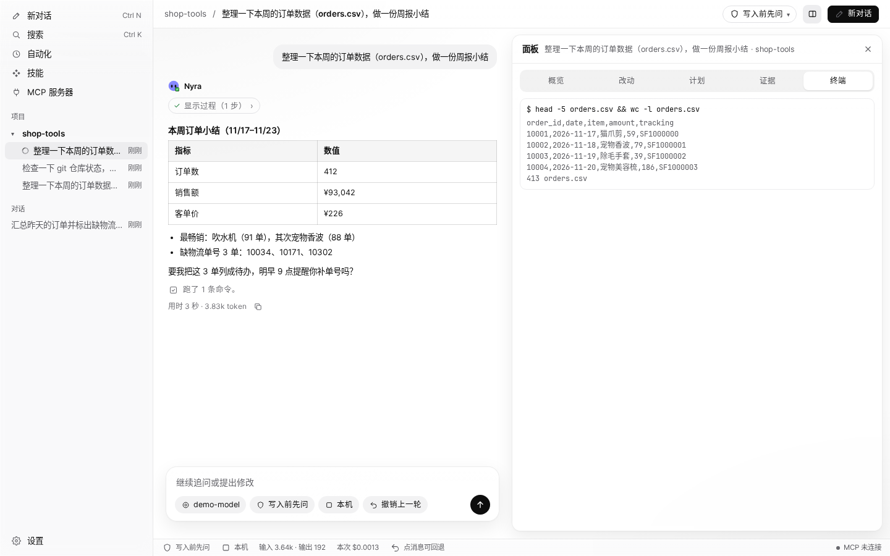
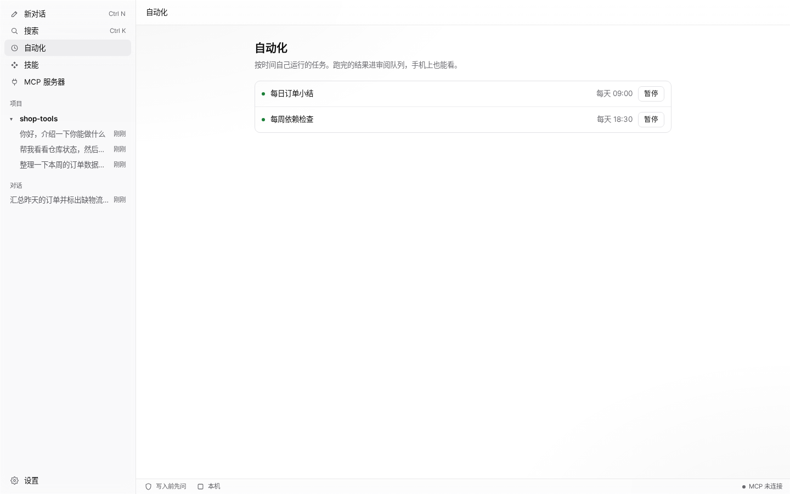
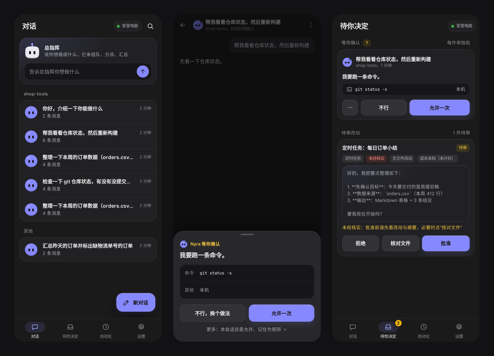
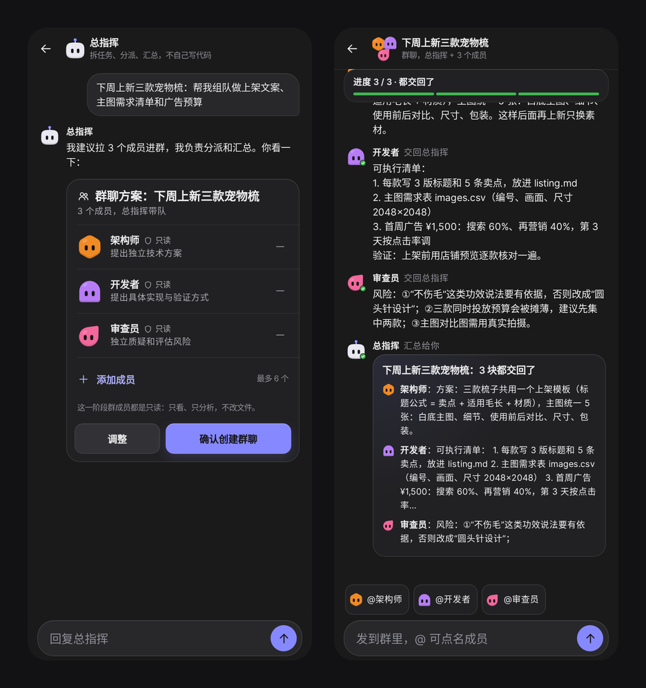
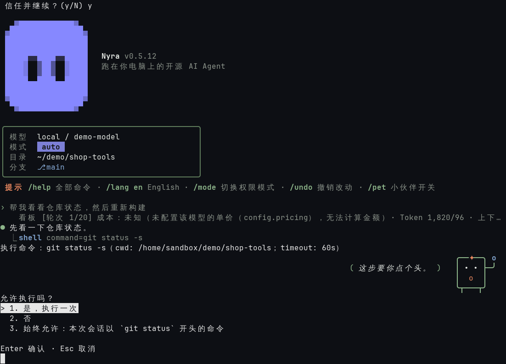
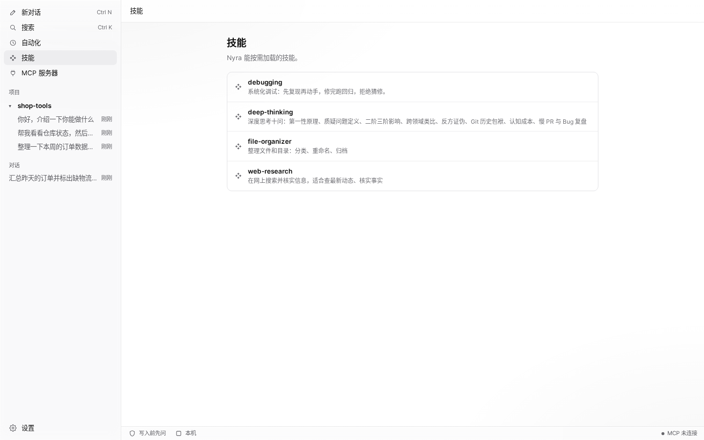
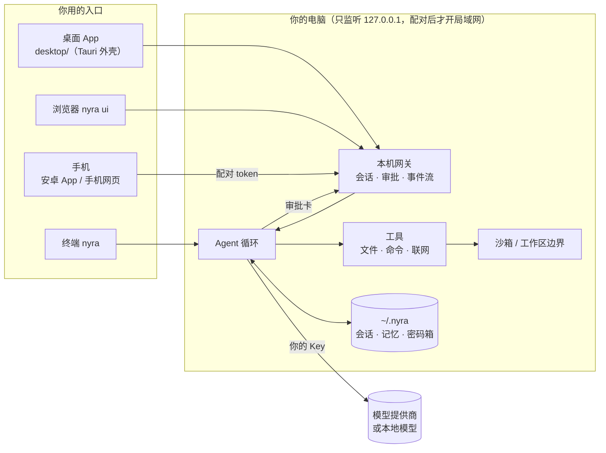

<div align="center">


# Nyra

**跑在你自己电脑上的开源 AI Agent：读项目、改代码、跑命令、联网查证，动手之前先问你。**

[官网](https://js2005happy.github.io/nyra/) &nbsp;·&nbsp; [下载](https://github.com/js2005happy/nyra/releases/latest) &nbsp;·&nbsp; [上手说明](docs/beta.md)

Nyra 是一个**开源**、**跑在你自己电脑上**的 AI Agent：**桌面窗口**、**终端**、**浏览器**里都能用，**手机**配对后还能远程看进度、点批准。模型用**你自己的 Key**（也能接本地模型），对话、记忆和密钥都**留在本机**。

交给它一件事，它会自己读项目、改代码、跑命令、联网查证；写文件、跑命令之前，先弹一张审批卡写清这一步要做什么。说一句话交代任务。看它一步步做。要紧的那一步，你点头它才动。

[](https://github.com/js2005happy/nyra)
[](https://github.com/js2005happy/nyra/releases/latest)
[](docs/mobile-pwa.md)
[](https://github.com/js2005happy/nyra/releases/latest)
[](https://github.com/js2005happy/nyra/actions/workflows/node-ci.yml)
[](CONTRIBUTING.md)

<br>

<a href="https://github.com/js2005happy/nyra/releases/latest/download/Nyra-windows-x64-setup.exe"></a>

<a href="https://github.com/js2005happy/nyra/releases/latest/download/Nyra-macos-universal.dmg"></a>

<a href="https://github.com/js2005happy/nyra/releases/latest/download/Nyra-linux-x86_64.AppImage"></a>

<a href="https://github.com/js2005happy/nyra/releases/latest/download/Nyra-linux-amd64.deb"></a>

<a href="https://github.com/js2005happy/nyra/releases/latest/download/nyra-android.apk"></a>

<sub>[最新版本](https://github.com/js2005happy/nyra/releases/latest) &nbsp;·&nbsp; Windows x64 安装包：**未做代码签名**，首次运行会有 SmartScreen 提示（「更多信息 → 仍要运行」） &nbsp;·&nbsp; macOS 通用版 `.dmg`（Apple 芯片与 Intel）：只有 ad-hoc 签名、**未经 Apple 公证**，首次打开需右键「打开」 &nbsp;·&nbsp; Linux x64：AppImage 或 `.deb` &nbsp;·&nbsp; Android APK：**正式签名**（签名者 CN=Nyra）；从旧的临时签名版升级需先卸载一次，之后可直接覆盖升级 &nbsp;·&nbsp; [全部版本](https://github.com/js2005happy/nyra/releases) &nbsp;·&nbsp; [English](README.en.md)</sub>

<br>


<sub>真实运行界面，演示对话为脚本数据。</sub>

</div>

---

## 为什么做 Nyra

- **活交给它，决定留给你。** 改文件前给你看改什么，跑命令前给你看命令原文，联网、写出工作目录这些都有边界。默认每一步都问；信得过的任务再切到完全访问。
- **在你自己的电脑上，用你自己的 Key。** 没有中间服务器：模型请求从你的电脑直接发给你选的模型提供商，会话、记忆、密钥都在本机 `~/.nyra` 里。
- **做完的事看得见、退得回。** 每一轮跑了哪些命令、改了哪些文件、花了多少 token 都在右侧面板里；改错了一键撤销上一轮，回到之前的检查点。

## 功能

<table>
<tr>
<td width="50%" valign="top">

### 🛡️ 动手之前先问

写文件、跑命令前出现审批卡：这一步要跑什么、在哪个项目里跑。可以「允许一次」、本会话都允许，或者回一句「不行，换个做法」。约 10 分钟不处理自动拒绝。



</td>
<td width="50%" valign="top">

### 📋 过程都在面板里

右侧面板分概览、改动、计划、证据、终端五页。跑过的每条命令和输出都留着，不用翻聊天记录。



</td>
</tr>
<tr>
<td width="50%" valign="top">

### 📝 结果直接能读

回复里的表格、列表、代码块直接渲染（转义 HTML、拦危险链接）。输入框下面就是「撤销上一轮」。



</td>
<td width="50%" valign="top">

### ⏰ 定时自动跑

`nyra schedule add` 或在「自动化」里建定时任务，到点自己跑，结果进审阅队列，手机上也能看。



</td>
</tr>
<tr>
<td width="50%" valign="top">

### 📱 手机上看进度、点批准

电脑上 `nyra ui --pair`，手机（安卓 App 或手机浏览器）扫码配对，就能看对话、发任务、批准操作。工具仍在电脑上执行，手机只连你这台电脑。



</td>
<td width="50%" valign="top">

### 🤝 总指挥组队

一句话交给总指挥，它提议拉几个成员（架构师、开发者、审查员）进群、分派、汇总；建群前你确认，成员默认只读。



</td>
</tr>
<tr>
<td width="50%" valign="top">

### ⌨️ 终端里也一样

`nyra` 进交互模式，审批、`/undo` 撤销、`/mode` 切权限、`/model` 换模型都在终端里完成。



</td>
<td width="50%" valign="top">

### 🧩 技能与 MCP

技能平时只占一句话简介，用到才加载全文；也能接 MCP 服务器扩展工具。



</td>
</tr>
</table>

**也已经有：** 先计划后执行（`--plan` 只读写出 `plan.md`，按 SHA-256 批准那一版再执行）· 检查点与 `/rewind` · 项目记忆（`AGENTS.md`、`MEMORY.md`，都是普通文件）· 联网查证并存证据 · 每任务成本硬顶与每日上限 · 本地密码箱存 Key · 十几个模型预设与本地模型。

**即将推出：** 手机端用账号登录（不在同一 Wi-Fi 也能连电脑；App 里的按钮已在，目前点了只提示「即将推出」）· Windows / macOS 代码签名与公证。

<sub>截图均为真实运行界面，演示对话为脚本数据（本地假模型按剧本回复）。</sub>

## 更新了什么

**A2A 对齐 v1.0（2026-11-28）**：Nyra 对外暴露成 A2A agent 的那套，照 A2A v1.0（2026-03-12 生产稳定版）对齐了一遍。名片改成 v1.0 的形状：地址放 `supportedInterfaces[0]` 里、能力里多了 `stateTransitionHistory` 与 `extendedAgentCard: false`（扩展卡片没做，调了回 -32601），技能带标签和示例。签名也升了一级：签名前先把名片按 RFC 8785 规范化（键怎么排都不影响验签了），名片上同时带 v1.0 的 `signatures[]` 和老版紧凑 JWS，老对方还能认。发现和加好友现在只收验过签名的名片——没签名、改过、过期的一律拒绝，不进账本；对方得先跑 `nyra peer card keygen` 再开 `nyra peer card sign on` 才会被发现。任务信封线上也走 v1.0 的写法：状态是 `TASK_STATE_*`、角色是 `ROLE_USER`/`ROLE_AGENT`、part 没 `kind`、Task 带创建时间与修改时间、错误 data 是 google.rpc.ErrorInfo、列表支持游标分页、流式事件包在 `taskStatusUpdate` / `taskArtifactUpdate` 里。对方发来的话进模型前打一层不可信标记（`[untrusted-content kind="peer" ...]`），账本里仍存原文。工具总数没变，还是 53。

- 诚实边界：只在临时 home / 假 provider / 假对端上验过；真 A2A 客户端（ADK / LangGraph 等）没接过；注入没解决，扫描 + 标记 + 审批是兜底，不是根治；Windows/macOS 真机未验证；gRPC 与多租户不做。

**致命三元组检查进了 doctor（2026-11-27）**：Nyra 同时有三样东西——能读你的邮箱文件、能看网上的东西、能往外发东西——三样齐了，一段网上的坏内容就能骗它把你的东西发出去。现在每轮任务都记着这三条腿各走了哪一步：三条腿齐了，本轮所有写操作都必须人批，批了才执行，没人可问就直接拒绝；`nyra doctor` 里也多了一项，专门报这三条腿齐没齐、守卫开没开。不可信内容（网页、邮件、第三方返回）进上下文前，除了中文框线，还多了一行机器能读的标签 `[untrusted-content kind="..." source="..." integrity="untrusted"]`，下游不用猜这段是不是外部来的；内容里伪造的同款标签会被中和掉，伪造者改不了自己内容的定级。关掉守卫的口子是 `NYRA_TRIFECTA_GUARD=0`，关了 doctor 会报失败。工具总数没变，还是 53。

- 诚实边界：只在临时 home / 假 provider 上验过；真模型没跑；注入没解决，标记 + 隔离 + 审批是兜底，不是根治；Windows/macOS 真机未验证。

**工具调用开了严格模式（2026-11-27）**：以前工具参数是“模型说是什么就是什么”，schema 只发给模型看，吐错了参数要等执行层撞上才知道。现在两层兜底：支持 strict 的 provider（OpenAI、xAI、通义千问、Together）默认发 `strict: true`，参数 schema 先归一化成 strict 子集（全部对象不许多余键、全部属性必填、可选的可以填 null），服务端在解码期就拦住坏参数；不支持的（DeepSeek、OpenLux、OpenRouter 等）走二次校验——工具调用回来先按 schema 验一遍，不对就只重试一次，重试还不对就不执行、把错处当结果回填给模型自己纠正。不能 strict 化的工具（比如委派任务的自由格式契约）原样发，照样走校验重试。开关在环境变量 `NYRA_STRICT_TOOLS`（`0` 全关），自定义 provider 也能在配置里写 `strict_tools`。工具总数没变，还是 53。

- 诚实边界：只在临时 home / 假 provider 上验过；真模型没跑；Windows/macOS 真机未验证。

**工具检索／懒加载（2026-11-27）**：53 个内置工具不再每轮全量发给模型了——每轮只发常驻核心集 10 个（读文件、列目录、搜代码、跑命令、写文件、改文件、联网搜、搜记忆、看 git 状态、写计划），其余按任务关键词召回、最多 8 个，缺了就用 `search_tools` 现场拉回；`NYRA_LAZY_TOOLS=0` 能一键关掉。每个工具的描述都补齐了“何时用／何时不用／典型误用”，模型选工具时少猜错。工具之间也记上了依赖：改文件前要先读文件、点按钮前要先打开页面、发群聊前要先建会话，依赖的还没跑完就先等着，不凭印象编参数。顺带合掉了一对真重复的工具——`memory_delete` 和 `memory_forget` 其实是同一个，只留 `memory_forget`，工具总数 54 → 53，老名字还能用，只是模型看不到了。
**月度限额全去了（2026-11-27）**：Nyra 里再也没有月度花费上限——`monthly_cost_limit_usd`、`--monthly-max-cost`、分层 caps 的月度维、首次花钱必选上限的那道门，全拆了。旧配置里写了月度上限也不再生效，设置端点再收到这个键会直接报不支持。本月花了多少照常能看见（记账和展示没动），拦花费的只剩两样：每次任务自己的成本硬顶（`--max-cost` / `max_cost_usd`），和每个 Bot 每天的上限（分层 caps 现在只剩 agent 每日层，`--day-usd` / `--day-tokens`）。`nyra cost --show --json` 和 `nyra stats --json` 不再输出上限字段。工具总数没变，还是 54。

- 诚实边界：只在临时 home / 假 provider 上验过；真模型没跑；Windows/macOS 真机未验证。注意一个行为变化：以前没配单价时、有月度上限兜着会“金额未知，已暂停”，现在没设任何美元上限时不会再因此暂停——只有设了每任务硬顶时才会在金额未知时暂停。
**手机端往 Cue 靠齐：探索页、个人页、邀请制、Bot Mode 开关（2026-11-27）**：手机页 `/m` 底栏从 4 个加到 6 个。探索页是 6 张任务模板卡片（寄包裹、找房、找显示器、补满冰箱、省钱、预订票），点一下在群聊里开一轮执行——模板只是开场白，Bot 会先问清缺的信息再动手，不编地址、价格和结果。个人页是用量、钱包、应用、邮箱、电话、技能、电脑六个入口加邀请区：用量、应用、电脑接的是现成的账本和状态，邮箱如实显示 Gmail 收发闭环仍在排查，钱包和电话先只放入口、点进去说“即将推出”。邀请制是邀请码加名额账本，一共 5 个名额，发码占一个、吊销就释放，但云端登录后端还没部署，码现在兑现不了注册，界面上明说了。Bot Mode 开关在设置页的“群聊”分区，CLI 里也有同一个开关，默认开，关了群聊就不跑 Bot 轮次。工具总数没变，还是 54。

- 诚实边界：只在临时 home / 假 provider 上验过；真模型没跑；真机未验证；钱包、电话、邀请注册是入口或账本，不是已上线的功能。

**群聊向 Hermes Bot Mode 靠齐（2026-11-27）**：群聊会话补了六件小改动，都是 Hermes Bot Mode 那边有的做法。`@所有人` / `@all` 一喊，房间里所有 Bot 按顺序各说一轮，不建指派；一场会话里 Bot 成员 2–6 个，多了进不来；每条消息最多 10 条发言，以前默认 3 轮 × 20 条能跑到 60 条，现在收紧了；新 Bot 进群先自我介绍一条；每个成员能带自己的技能，轮次里按技能过滤它能用的工具（没技能或技能没声明工具时不限，跟以前一样）；本地建房间和邀请时也能顺带指定 provider/model，不给就走默认链。工具总数没变，还是 54。

- 诚实边界：只在临时 home / 假 provider 上验过；真模型没跑；Windows/macOS 真机未验证。

**别家连接对齐：GitHub 只读、RSS、本地 MCP、Telegram 与 GitHub 远程 MCP（2026-11-27）**：先看别的智能体都接什么，Nyra 一样接上——五个最小连接里三个已真接口跑通，两个的接线与验证步骤写好了，等一个你的一次性步骤。本地 MCP 预置（memory / filesystem / fetch）本来就有，补了文档和测试：fetch 只能走 uvx——官方没有出过这个服务器的 npm 包。两个新的只读工具：`github_repo_read`（读仓库的 README 或指定文件）和 `github_search`（搜仓库和 issue），都不用 token；`feed_read`（读 RSS/Atom，内置 GitHub Blog、Hacker News、Nyra Releases 三个源，也能自己加订阅）。Telegram 那边：适配器早就在了，验证步骤写进了文档——你在 @BotFather 建个测试 bot、把 token 给我，我就按步骤跑通；GitHub 官方远程 MCP（只读）也接好了预置，等你生成一个只读 PAT。工具总数 51 → 54。

- GitHub 两个工具和 RSS 工具都在真实接口上验过：读 Nyra 仓库的 README、搜仓库、读三个源的首条都对；限额耗尽、404、坏输入都按规矩报错，不编造。
- fetch 的内容抓取是在直接拉起服务器时验过的——经 Nyra 派生的子进程拿不到本机出口代理的凭据，正常机器没有这个问题；`--allow-private-ips` 只用于探针，绝不进预置。
- CLI-Anything 第一批（LibreOffice + GIMP）没进本批：装 `cli-anything-hub` 时触发了执行风险检查，已停手，等你点头再继续。
- 诚实边界：Telegram 和 GitHub 远程 MCP 的真接口跑通各等一个你的步骤；Windows/macOS 真机未验证。

**语义事实：记忆提炼成带时间戳的原子事实（2026-11-26）**：以前的记忆只有两种形态——MEMORY.md 里的一段话，或者结构化记忆库里的一条记录。现在确认进库的记忆还会多记一条“语义事实”：一句话、一个主题、一个类别，附上逐字依据、来源会话和关联的记忆条目，带生效时间与有效期。同一件事后来变了怎么办？旧事实不删，标上“被取代”，新旧两条都留着，查的时候默认只看生效中的那条。有效期到了（比如“这个月在用试用套餐”）就自动标过期，做梦代谢每夜扫一遍。

- 抽取默认是关的：开了才在做梦代谢里每会话用小模型（默认就是 flash 级）提炼一遍，`nyra memory extract <会话 id> --model` 也能手动提一次；不管哪条路，抽出来的都只是候选，先进待审队列、你点了确认才进库，绝不静默写记忆。
- 抽取不再过月度上限（已移除）；一次最多 5 条，依据必须是你的原话，模型编造的引用进不了队列；花了多少记进当月账本。
- 主循环里会按需把相关的事实附在记忆段后面（最多 5 条），没事实时什么都不加。命令是 `nyra memory facts <list|show|search|expire>`。诚实边界：只在临时 home / 假 runner 上验过，真模型没跑；抽取用默认 provider，默认 provider 换成贵模型时抽取跟随；Windows/macOS 真机未验证。

**MCP 升到 2026-07-28 无状态规范（2026-11-26）**：2026 年 7 月的 MCP 规范把会话整个砍掉了——没有握手、没有会话 id，每个请求自己带上协议版本。以前 Nyra 的 HTTP 客户端还会把服务端给的会话 id 存下来、后续请求再带上，现在不存了也不发了；对外服务那边补上了 `server/discover`，客户端先探版本再干活，带了不支持的版本会明确回 -32022 并告诉你它支持哪个版本。老服务器、老客户端还能用：不会 discover 的那头会回退到旧版 `initialize` 握手，只是这条路不再是默认。

- 每个 HTTP 请求都带 `MCP-Protocol-Version` 头，值跟 `_meta` 里的一致；stdio 传输没变。
- 对外服务的 `server/discover` 回支持的版本列表、能力、`_meta` 里的 serverInfo，还有缓存提示（`ttlMs` 取 0，工具列表随写开关变，每次现取）。
- 诚实边界：只在临时 home / 假服务器上验过，真 MCP 服务器（新版与老版）还没实测；对外服务只回 JSON、不做 SSE 流式回包；`resources`/`prompts` 不支持，只有 tools；Windows/macOS 真机未验证。

**Bot 群聊会话（2026-11-26）**：以前的群聊房只是个房间——机主在外面看着，Bot 们按顺序各说各的。现在可以开一个真正的联合会话：机主是正式成员，能直接在会话里说话、@ 某台 Bot 交活、看每台 Bot 在干什么。

- 轮次有规矩：@ 点名优先，其次是交接（上一条里写 `HANDOFF: 某 Bot`），再是指派、路由、轮询；同一台 Bot 连说 2 轮就换人，一轮最多 20 条，机主一提问就只跑 1 轮。
- 每台 Bot 的账分开记：发言前按成员预留预算，某台触顶只停它自己；批准也是按（Bot，工具）记的，一次性消耗，别台的批准不能复用。
- @ 点名会自动建一条可跟踪的指派，负责人回一句“完成”就结掉，5 轮没动静的指派会标出来；名片邀请进来的成员只读，回复也要过拦截器。
- 命令是 `nyra group session <create|list|show|send|members|assign|done|presence|invite|end>`，模型也能用三个新工具（`group_session_create` / `group_session_send` / `group_session_assign`，工具总数 48→51）。诚实边界：会话搜索（FTS5）本批没接，会话靠会话文件 + 运行事件 + `show` 查；预算预留默认是 0（生产上限还没接真数），每 Bot 分开记账与触顶只停该 Bot 的逻辑是假账本验的；只在临时 home / 假 provider 上验过，真模型没跑，Windows/macOS 真机未验证。

## 工作原理



| 层 | 目录 | 做什么 |
|---|---|---|
| 命令行入口 | `src/cli.ts` | `nyra` 全部子命令、交互模式、`nyra ui` 启动网关 |
| Agent 循环 | `src/agent.ts`、`src/agent/` | 调模型、调度工具、审批、检查点、验证 |
| 工具 | `src/tools.ts`、`src/tools/` | 读写文件、`apply_patch`、shell、联网搜索与抓取、委派子 agent |
| 模型 | `src/providers.ts`、`src/providers/` | 各模型提供商的接入、备用链、用量与花费 |
| 本机网关 | `src/gateway.ts`、`src/gateway/` | HTTP + 事件流：会话、审批、设置、手机配对 |
| 界面 | `src/webuiDesktop.ts`、`src/webuiMobile.ts`、`src/assets/` | 桌面网页界面与手机页（`/m`），不加载外部资源 |
| 沙箱 | `src/sandbox.ts`、`src/windowsSandbox.ts` | bwrap（Linux）/ Seatbelt（macOS）/ Job Object（Windows）/ 工具级隔离 |
| 记忆 | `src/memory.ts`、`src/memory/`、`src/vault/` | 会话存档、项目记忆、本地密码箱 |
| 扩展 | `src/mcp/`、`src/connectors/`、`src/channels/`、`skills/` | MCP、连接器、消息渠道、内置技能 |
| 配对 | `src/pairing.ts`、`src/pairing/` | 6 位配对码、设备 token、配对加密 |
| 桌面 App | `desktop/` | Tauri 2 外壳：启动自带的同版本 CLI，窗口显示本机网关页面 |
| 安卓 App | `mobile/` | Capacitor 外壳：启动器连电脑上的手机页 |
| 构建与安装 | `scripts/`、`.github/workflows/` | 单文件二进制、安装脚本、桌面/安卓打包、签名 |
| 测试 | `tests/node/` | 全部 mock，无需 Key |

## 快速开始

### 1. 下载安装

| 平台 | 下载 | 安装 |
|---|---|---|
| **Windows**（x64） | [Nyra-windows-x64-setup.exe](https://github.com/js2005happy/nyra/releases/latest/download/Nyra-windows-x64-setup.exe) · [.msi](https://github.com/js2005happy/nyra/releases/latest/download/Nyra-windows-x64.msi) | 双击安装，按用户安装不需要管理员。未做代码签名：SmartScreen 提示时点「更多信息 → 仍要运行」。 |
| **macOS**（Apple 芯片与 Intel） | [Nyra-macos-universal.dmg](https://github.com/js2005happy/nyra/releases/latest/download/Nyra-macos-universal.dmg) | 拖进「应用程序」。未经公证：第一次右键点 Nyra 选「打开」。 |
| **Linux**（x64） | [Nyra-linux-x86_64.AppImage](https://github.com/js2005happy/nyra/releases/latest/download/Nyra-linux-x86_64.AppImage) · [Nyra-linux-amd64.deb](https://github.com/js2005happy/nyra/releases/latest/download/Nyra-linux-amd64.deb) | AppImage：`chmod +x` 后运行；Debian/Ubuntu：`sudo apt install ./Nyra-linux-amd64.deb`。 |
| **Android** | [nyra-android.apk](https://github.com/js2005happy/nyra/releases/latest/download/nyra-android.apk) | 允许安装未知来源后安装；打开后填电脑地址与配对码。正式签名；从旧的临时签名版升级需先卸载一次，之后可直接覆盖升级。 |
| **iPhone** | 手机网页 | 电脑上 `nyra ui --pair`，Safari 扫码打开后「添加到主屏幕」（没有 IPA）。 |

桌面安装包自带同版本的 `nyra` 命令行。只想要命令行：

### 2. 一键安装命令行（可选）

```bash
# Linux（x64 / arm64）
curl -fsSL https://raw.githubusercontent.com/js2005happy/nyra/main/scripts/install-node.sh | bash
# macOS（Apple 芯片 / Intel）
curl -fsSL https://raw.githubusercontent.com/js2005happy/nyra/main/scripts/install-node-macos.sh | bash
```

```powershell
# Windows（PowerShell）
irm https://raw.githubusercontent.com/js2005happy/nyra/main/scripts/install-node.ps1 | iex
```

脚本只写你的家目录，下载后先对 Release 里的 `SHA256SUMS` 校验，对不上就拒绝安装。装完：

```bash
nyra setup     # 首次设置向导（中文）
nyra doctor    # 自检：Key、网络、目录权限
nyra           # 交互模式；nyra ui --open 打开网页界面
```

### 3. 从源码运行

```bash
git clone https://github.com/js2005happy/nyra.git && cd nyra
bun install
bun run src/cli.ts                 # 交互模式（需要 Bun ≥ 1.4）
bun run src/cli.ts ui --open       # 本地网页界面
bash scripts/build-binaries.sh --only linux-x64   # 编单文件二进制到 dist/
```

### 4. 配一个 Key（选一个即可）

没有 Key 也能跑 `--help`、`--version`、`--list-providers`，不联网不花钱。桌面 App 的首次设置里可以直接粘贴 Key，测试连接通过后才保存到本机。

| 提供商 | 环境变量 | 默认模型 |
|---|---|---|
| deepseek（默认） | `DEEPSEEK_API_KEY` | `deepseek-flash` |
| openai | `OPENAI_API_KEY` | `gpt-4o-mini` |
| xai | `XAI_API_KEY` | `grok-4.3` |
| qwen（通义） | `DASHSCOPE_API_KEY` | `qwen-plus` |
| kimi | `MOONSHOT_API_KEY` | `kimi-k3` |
| glm（智谱） | `ZHIPU_API_KEY` | `glm-5.3` |
| gemini | `GEMINI_API_KEY` | `gemini-2.5-flash` |
| ollama（本地） | 不需要 | `qwen2.5:7b` |
| custom（任意 OpenAI 兼容接口） | `NYRA_API_KEY` + `NYRA_BASE_URL` + `NYRA_MODEL` | 你指定 |

全部预设：`nyra --list-providers`；详见 [完整手册](GUIDE.md#配置模型)。

## 平台能力

| 功能 | Windows | macOS | Linux | Android | 手机网页 |
|---|---|---|---|---|---|
| 桌面窗口 App | ✅ `.exe` / `.msi` | ✅ `.dmg`（通用） | ✅ AppImage / `.deb` | — | — |
| 命令行 `nyra` | ✅ x64 | ✅ arm64 / x64 | ✅ x64 / arm64 | — | — |
| 本地网页界面 `nyra ui` | ✅ | ✅ | ✅ | — | — |
| 审批卡（写文件、跑命令前确认） | ✅ | ✅ | ✅ | ✅ 远程批准 | ✅ 远程批准 |
| 配对后远程看对话、发任务 | ✅ 被连的电脑 | ✅ 被连的电脑 | ✅ 被连的电脑 | ✅ | ✅ |
| 定时任务 | ✅ | ✅ | ✅（可装 systemd 常驻） | 查看结果 | 查看结果 |
| 命令沙箱 | 工具级；进程级 Job Object 需显式开 | Seatbelt（自动） | bwrap（装了就用） | — | — |
| 账号登录（不在同一 Wi-Fi） | — | — | — | 即将推出 | 即将推出 |
| 安装包签名 | 未签名 | ad-hoc，未公证 | — | 正式签名（CN=Nyra） | — |

<sub>✅ 表示功能已实现并有自动化测试。Windows 桌面版在 CI 的 Windows 虚拟机里实际跑过（上面的截图即来自那里）；macOS 与安卓尚未在真机上验证。</sub>

## 状态

0.5.x，可以日常试用，仍在快速迭代。已知的边界：桌面安装包还没有正式代码签名（安卓 APK 已正式签名）；macOS 与安卓没有在真机上验证过；本机网关在局域网里走明文 HTTP（配对 token 已加密交换，整条连接的 HTTPS 还没做）；手机账号登录即将推出。问题和建议请提 [issue](https://github.com/js2005happy/nyra/issues)，内测说明见 [docs/beta.md](docs/beta.md)。

## 隐私

- 不上报使用数据：可观测数据（trace、计数）只写在本机 `~/.nyra`，导出要你自己配置。
- 更新检查默认关闭，开了才去 GitHub 查新版本。
- API Key 存在本机密码箱或 `~/.nyra/keys.json`，不写进项目文件和日志；网页版不输入也不保存 Key。
- 模型请求从你的电脑直接发给你选的提供商，提示词与上下文受该提供商的条款约束。详见 [隐私政策](https://js2005happy.github.io/nyra/privacy.html)。

## 参与共创

Nyra 正在内测，欢迎来试、来提意见，也欢迎一起改进：

- **反馈入口**：[内测招募 & 反馈入口](https://github.com/js2005happy/nyra/issues/131)（置顶）· [提 Bug / 体验反馈](https://github.com/js2005happy/nyra/issues/new/choose)（请勿贴 API Key）
- **讨论**：[Discussions](https://github.com/js2005happy/nyra/discussions)——「内测反馈」「想法」「展示」分类
- **上手做点事**：[good first issue](https://github.com/js2005happy/nyra/issues?q=is%3Aissue+is%3Aopen+label%3A%22good+first+issue%22) 里是可以独立完成的小任务，留言认领即可
- **怎么提交**：开发流程、测试命令和提交约定见 [CONTRIBUTING.md](CONTRIBUTING.md)

## 参与贡献

欢迎 PR 和 issue。开发流程、测试命令和提交约定见 [CONTRIBUTING.md](CONTRIBUTING.md)；安全问题请按 [SECURITY.md](SECURITY.md) 私下报告；参与即表示同意 [行为准则](CODE_OF_CONDUCT.md)。

```bash
bun x tsc -p tsconfig.json --noEmit   # 类型检查
bun test tests/node                    # 全部测试（mock，无需 Key）
```

更多文档：[完整手册](GUIDE.md) · [全部命令](docs/COMMANDS.md) · [路线图](ROADMAP.md) · [签名状态](docs/SIGNING.md) · [桌面 App](docs/desktop.md) · [手机](docs/mobile-pwa.md) · [安装包与发版](docs/installers.md)

## License

[MIT](LICENSE)
